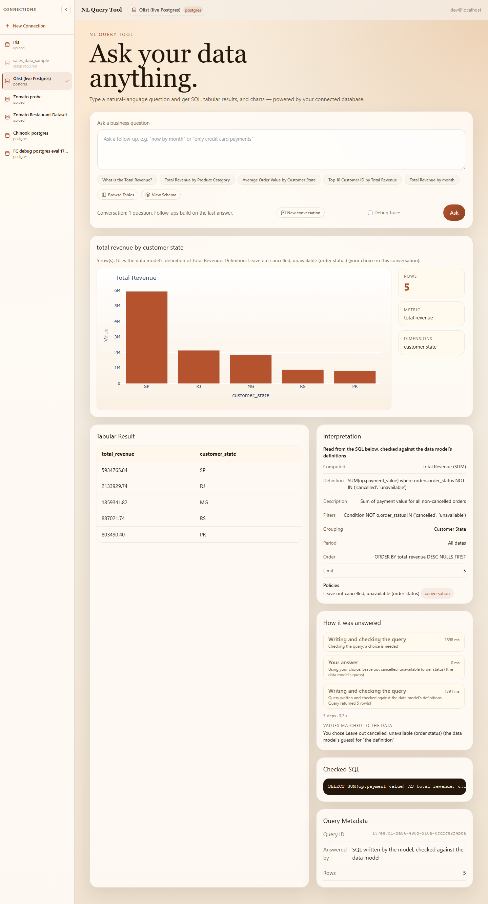
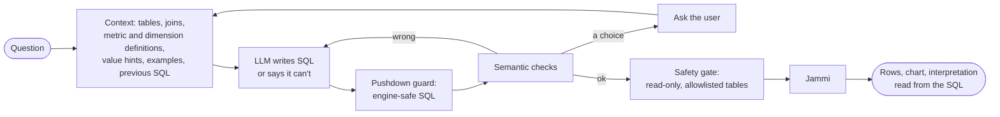

# NLviz: ask a database a question in plain English

NLviz is a local portfolio demo. Connect a PostgreSQL or MySQL database, or upload a CSV, Excel or
Parquet file, and ask business questions. NLviz builds a data model for the source with an LLM. Each
question is answered with SQL that the model writes from that data model. Before it runs, the SQL is
**checked against the data model's definitions**. The query runs on the
[Jammi](https://github.com/f-inverse/jammi-ai) engine, and the answer comes with a table, a chart,
and an interpretation read from the SQL that ran. When a question is ambiguous it asks; when the
data cannot answer it, it says so.



> **Answers can be wrong.** On a sealed holdout the app answered 43.9% of first questions correctly
> and 30.9% wrongly with a free local model ([results](#results)). The metric definitions are
> generated and inferred, not confirmed by a person. This is a demo of an architecture and an
> evaluation method, not a dependable analyst.

## How a question is answered



The checks (`backend/app/services/sql_checks.py`) read the SQL's syntax tree, tracing columns through
CTEs and subqueries:

| Check | What it prevents |
|---|---|
| Double counting | Adding up one table across a join that repeats its rows (order totals summed over order lines). Predicted from the join graph, then confirmed on the data. |
| Agreed definitions | Dropping a metric's condition ("revenue excludes canceled orders"), unless the question asks to |
| Mixed units | One figure across several currencies: the user picks one, or a breakdown by currency |
| Zero placeholders | Averaging zeros that may mean "not recorded" |
| Values | Filtering on a value no row has ("Rio": rio de janeiro, or another city?) |
| Definitions | Applying an unconfirmed business definition that changes the answer (do canceled orders count? which statuses?). Asked before running, answered once per conversation, or kept for the connection when the user says so |

A failed check goes back to the model. A choice goes to the user, and the regenerated SQL must
satisfy it. The checks went through three rounds of adversarial review. Each
defect found is a regression test, and the remaining limits are documented in
[current-architecture.md](docs/architecture/current-architecture.md) §5.2.

**Why SQL-primary.** NLviz began with the LLM writing a structured intent that a deterministic
compiler turned into SQL. A controlled comparison on 139 questions over three unseen databases found
that the same model writing SQL from the same context did better with both models tried:
- local 4B model: 62 vs 44 correct first answers;
- gpt-4.1-mini: 71 vs 52.

No question was answered correctly by the compiler alone. The semantic layer now supplies the
context, the definitions and the checks. The compiler remains for edited interpretations and for
running without a model. The full record is in [ablation-results.md](docs/ablation-results.md).

## Results

**Sealed holdout:** three databases, 123 turns, written by another agent and never seen during
development. It was run once after the code was frozen ([freeze manifest](docs/freeze-manifest.md)).

| Arm | Model | Correct first answer | Wrong | Final correct |
|---|---|---|---|---|
| SQL-primary (the app) | local `qwen3:4b-instruct-8k` | 54 (43.9%, 95% CI 35–53%) | 38 (30.9%) | 69 (56.1%) |
| Text-to-SQL, no semantic checks | local `qwen3:4b-instruct-8k` | 52 (42.3%) | 45 (36.6%) | 67 (54.5%) |
| SQL-primary (the app) | `gpt-4.1-mini` | 58 (47.2%, 95% CI 39–56%) | 40 (32.5%) | 73 (59.3%) |
| Text-to-SQL, no semantic checks | `gpt-4.1-mini` | 57 (46.3%) | 46 (37.4%) | 72 (58.5%) |

**Reading the results:**
- Refusals: every arm refused all 15 unsupported questions.
- The checks' effect: with both models, 6–7 fewer wrong answers, at the same or better accuracy.
  On 123 related turns the intervals overlap, so this is a direction, not a proven difference.
- Biggest weakness: questions that hinge on an unstated business policy (0–1 of 15). The
  definition questions described above were added after the holdout run in response, so they are not
  in these numbers.
- Owner review of the clarifications: the app asked 18 clarifications no scripted rule matched (11
  local, 7 hosted), and the author reviewed them by hand.
  - 5 were judged useful (4 local, 1 hosted), 6 unnecessary, and 1 is still under discussion.
  - The remaining 6 are follow-up turns that never ran.

  The machine-scored totals above stay as published.
- Cost: the hosted run cost $0.26 for both arms.

**Development set:** 139 turns, used to guide development.
- SQL-primary before the definition questions: 65 correct first answers and 49 wrong on the local
  model, and 71 and 49 on gpt-4.1-mini.
- The current build on the local model: 63 correct, 42 wrong and 11 definition questions. Final
  correctness is 81 of 139, within run-to-run variance.

**Tests:**
- 641 offline;
- about 720 live, against Jammi, Postgres, MySQL and S3;
- Playwright browser tests: 3 live and 4 mocked.

Each defect a review found has a regression test. One known issue is kept as an expected failure.

## Run it locally

Everything runs on your machine: the UI, the API, the Jammi query engine and the app database, as one
Docker Compose stack, with a free local model through Ollama. No account or API key is needed.

### What you need

- **Docker Desktop**, or Docker Engine with Compose v2. Give Docker at least **8 GB of memory**, and
  have about 10 GB free on disk for the images and the model.
- **[Ollama](https://ollama.com)**, running on the same machine (the containers reach it at
  `host.docker.internal:11434`).
- **Python 3**, only to generate two keys in step 2 (any Python with `cryptography` installed). On
  Linux, `openssl` works too.
- Optional: Node.js 20+ for the browser tests; an OpenAI or Anthropic key to use a hosted model.

### 1. Get the code

```bash
git clone -b v2-jammi https://github.com/skarthik1015/NLviz.git
cd NLviz
```

This README describes the `v2-jammi` branch; `main` still holds the earlier version.

### 2. Create `.env`

```bash
cp .env.example .env
```

Fill in the three empty values at the top of `.env`. Generate each once, then keep it: the secret
store key encrypts saved connection passwords, and changing it later makes them unreadable.

| Setting | How to generate it |
|---|---|
| `POSTGRES_PASSWORD` | any long random string, e.g. `python -c "import secrets; print(secrets.token_urlsafe(24))"` |
| `SECRET_STORE_KEY` | `python -c "from cryptography.fernet import Fernet; print(Fernet.generate_key().decode())"` |
| `JAMMI_SERVICE_TENANT` | `python -c "import uuid; print(uuid.uuid4())"` |

Leave everything else as it is: the defaults use the local model, SQL-primary answers and definition
questions. `.env` is git-ignored; never commit it.

### 3. Prepare the local model

The app expects `qwen3:4b-instruct-8k`: Qwen3 4B with an 8k context, which schema generation needs
(Ollama's default context is too small).

macOS / Linux:

```bash
ollama pull qwen3:4b-instruct
printf 'FROM qwen3:4b-instruct\nPARAMETER num_ctx 8192\n' > Modelfile
ollama create qwen3:4b-instruct-8k -f Modelfile
```

Windows (PowerShell):

```powershell
ollama pull qwen3:4b-instruct
"FROM qwen3:4b-instruct`nPARAMETER num_ctx 8192" | Set-Content Modelfile -Encoding ascii
ollama create qwen3:4b-instruct-8k -f Modelfile
```

### 4. Start the stack

```bash
docker compose up --build -d
docker compose ps        # jammi, postgres, backend and frontend should be running
```

The first build takes several minutes. The backend then needs a minute or two to prepare the bundled
sample data and its search index. It is ready when <http://localhost:8000/healthz> returns
`{"status":"ok"}`. To follow progress, run `docker compose logs -f backend`.

### 5. Try it

Open <http://localhost:3000>. The local development login (`DEV_USER_ID` in `.env`) signs you in
automatically.

- Bundled sample, no setup: on the start screen, choose **Or try the sample data**. Later, it's
  under **New Connection**. It is a Brazilian e-commerce dataset (Olist, shipped as
  `backend/data/ecommerce.duckdb`) with a hand-written data model. Try:
  - "How many orders are there?";
  - "Revenue by customer state, top 5", which first asks how revenue should be counted;
  - "Orders from customers in Rio";
  - "Will it rain tomorrow?" (refused: the data can't answer it).
- Your own data: choose **New Connection** to upload a CSV, Excel or Parquet file, or to connect
  a PostgreSQL or MySQL database. Then:
  1. Generate its data model: about a minute with the local model.
  2. Review the model.
  3. Publish it.
  4. Ask questions.

  For a database on your own machine, use `host.docker.internal` as the host and a read-only account.
- What to look at: the checked SQL, the interpretation panel (what was computed, under which
  definition and why), and the step trace. Answer a clarification if one appears, and try a
  follow-up. **New conversation** clears the context.

### Stop, reset, update

```bash
docker compose down        # stop; your connections and published data models are kept
docker compose down -v     # stop and delete all data (connections, uploads, app database)
git pull && docker compose up --build -d   # update
```

### Using a hosted model instead

In `.env`, replace the four model lines. For example, for OpenAI:

```
LLM_PROVIDER=openai
LLM_MODEL=gpt-4.1-mini
OPENAI_BASE_URL=https://api.openai.com/v1
OPENAI_API_KEY=sk-...
LLM_MONTHLY_BUDGET_USD=5
```

Then run `docker compose up -d backend`. `LLM_MONTHLY_BUDGET_USD` stops hosted calls once the month's
spend reaches it. Anthropic and per-task models are described in `.env.example`.

### Other settings

- `ANSWER_PATH=semantic` uses the intent compiler instead of SQL-primary.
- `DEFINITION_CLARIFICATIONS=off` applies the data model's guessed definitions without asking.
- MySQL databases are copied as a snapshot by default, for consistent answers (live MySQL federation is
  behind `MYSQL_FEDERATION=true`).

### If something doesn't work

| Symptom | Fix |
|---|---|
| Questions fail with a model or connection error | Check that Ollama is running and `ollama list` shows `qwen3:4b-instruct-8k`. On Linux, Ollama must listen on an address the containers can reach (`OLLAMA_HOST=0.0.0.0`). |
| Generating a data model fails or is cut short | The 8k model variant is missing (step 3), or Docker has too little memory. |
| Port 3000 or 8000 is already in use | Stop what is using it, or change the published ports in `docker-compose.yml`. |
| The backend restarts repeatedly | `docker compose logs backend`; usually an empty or invalid value in `.env` (step 2). |

### Run the tests

```bash
cd backend
python -m venv .venv && . .venv/bin/activate      # Windows: .venv\Scripts\activate
pip install -r requirements.txt
python -m pytest -q        # offline suite; live tests skip without JAMMI_TEST_* settings
cd ../frontend
npm ci
npx tsc --noEmit
npx playwright install chromium
npx playwright test --config playwright.mock.config.ts   # no backend needed
npx playwright test        # against the running stack; needs a published "Olist (live Postgres)" connection
```

**The benchmark** (`backend/eval/bench/`) needs its development databases loaded first: TPC-H on
PostgreSQL, the MySQL employees sample, and the NYC taxi files. Its README explains the loaders and
the harness. The sealed holdout is private and not in this repository.

## Repository map

| Path | What |
|---|---|
| `backend/app/agent/` | LangGraph agent: SQL-primary nodes, the compiler path, clarifications |
| `backend/app/services/sql_checks.py` | The semantic checks on generated SQL |
| `backend/app/semantic/` | Semantic layer models and the compiler |
| `backend/app/grounding/` | Value index (dense + BM25 + trigram, fused with RRF) in Jammi |
| `backend/eval/bench/` | Benchmark: cases, scorer, harness |
| `frontend/` | Next.js UI and Playwright tests |
| `docs/architecture/current-architecture.md` | The system as built, with its decision log |
| `docs/ablation-results.md` | Every measurement, with commits and models |

## Known issues

- **Definitions need one click.** A question that spells out a definition ("including canceled
  orders") still gets a one-click question. The app never decides a definition from the question's
  wording or from the SQL the model wrote.
- **Status questions use simple rules.** They apply to SUM and AVG of money-like measures, and look at
  status columns on the amount's table or a direct parent. They offer "every status" or one status;
  subsets can't be chosen.
- **A rare save race.** If saving a connection-wide definition fails while another save is in flight,
  the failed one can reappear after a restart. The answer is always kept for the conversation.
  (`tests/test_definitions_verify2.py`, an expected failure.)
- **The SQL checks have known limits.** They are not a proof against adversarial SQL; see
  [current-architecture.md](docs/architecture/current-architecture.md) §5.2.

## Not done

These are future work:
- a confirmation screen at publish (definitions are confirmed only through questions as they come up);
- questions about gross vs net amounts, and about which date a period refers to;
- entity identification beyond values;
- an editable interpretation;
- schema-change detection;
- a deployment. A [deployment plan](docs/deployment-plan.md) is written but not done.

There's no CI run yet.
