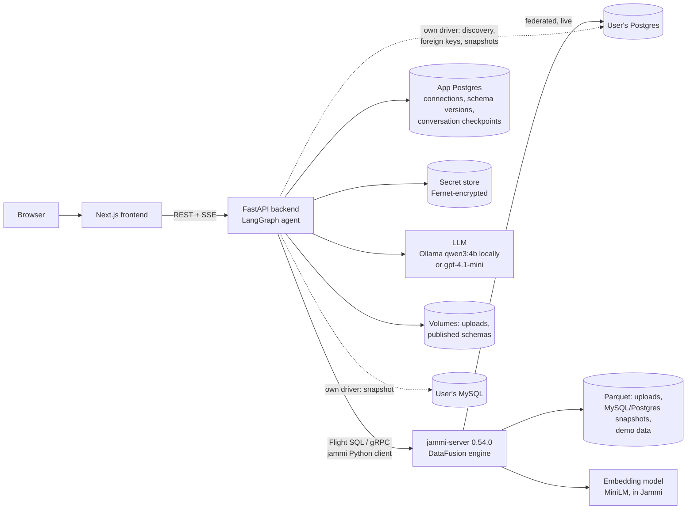
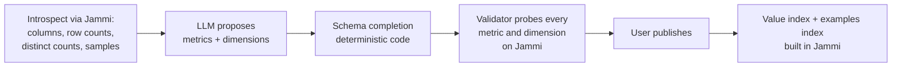
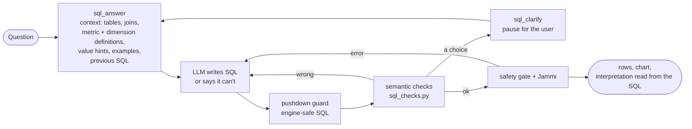
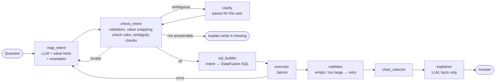

# NLviz on Jammi: current architecture and decisions

**As of:** 2026-10-19 (branch `v2-jammi`). Questions are answered by **SQL-primary**: the model writes SQL from the semantic layer's context, and the SQL is held to the layer before it runs (§5.2). The intent compiler of earlier versions remains for explicit intents and heuristic mode (§5.3). **Status:** a local portfolio demo, run as a Docker Compose stack; deployment is documented, not done ([../deployment-plan.md](../deployment-plan.md)).

This note describes the system as built, not as planned. The measurements are in [../ablation-results.md](../ablation-results.md); the documented deployment is in [../deployment-plan.md](../deployment-plan.md).

---

## 1. What NLviz does

A user connects a database (Postgres, MySQL) or uploads a file (CSV, Excel, Parquet), and asks questions in plain English: "revenue by month in 2018", "top 5 customers in Canada". NLviz builds a data model for the source with an LLM. Each question is answered with SQL the model writes from that data model. The SQL is checked against the model's definitions: double counting, agreed metric conditions, mixed currencies, zero placeholders, and values that don't exist. It runs on **Jammi**, and the answer comes with a table, a chart, and an interpretation read from the SQL that ran. When a question is ambiguous it asks; when the data cannot answer it, it says so.

**Why SQL-primary.** A controlled comparison on a 139-turn benchmark over three unseen databases ([../ablation-results.md](../ablation-results.md)) found that text-to-SQL given the semantic layer's context beat the intent compiler with both models:
- local 4B model: 62 vs 44 correct first answers;
- gpt-4.1-mini: 71 vs 52.

Not one question was answered correctly by the compiler alone. The semantic layer now supplies context, definitions and protections instead of being the only way to express a question. With the protections, SQL-primary scored 65 locally and 71 hosted, with the fewest wrong answers.

## 2. Components

| Component | Technology | Role |
|---|---|---|
| Frontend | Next.js 15, React 19, Plotly | Connection forms, chat with streamed steps, clarification chips, charts, trace panel |
| Backend API | FastAPI (Python 3.11) | Connections, schema generation and publishing, chat (`/chat`, `/chat/stream`, `/chat/resume`), auth |
| Agent | LangGraph | The question pipeline (§5), with a Postgres checkpointer for conversation memory and paused clarifications |
| Query engine | **jammi-server 0.54.0** (image pinned by digest) | Runs every query; holds every data source; builds and serves embedding and keyword indexes |
| App database | Postgres 16 | Connection profiles (with snapshot provenance), schema versions, LangGraph checkpoints, feedback (per owner). Generation jobs are held in memory and lost on restart |
| Secret store | Fernet-encrypted files locally (Secrets Manager in AWS) | Database credentials, plus what was read at connect time (declared joins, hidden columns, snapshot file URLs) |
| LLM | Ollama `qwen3:4b-instruct-8k` locally; `gpt-4.1-mini` measured and chosen for hosting | Four tasks (§6) |
| Storage | Docker volumes | Uploaded and snapshot Parquet (read by Jammi), published semantic schemas (YAML) |

## 3. How Jammi works within NLviz

**Jammi is the only query engine.** NLviz never runs user SQL itself. (One exception, local development only: without `JAMMI_DEMO_DATA_URL` the demo is served from the bundled DuckDB file; production refuses to start without it.) The backend reaches Jammi through one wrapper, `backend/app/jammi/client.py`, around the official `jammi` Python client, and one connector, `backend/app/connectors/jammi_connector.py`, which implements NLviz's `DataConnector` interface (schema introspection, queries) on top of it.

What NLviz uses Jammi for:

| Jammi capability | Used for | Where in NLviz |
|---|---|---|
| SQL over Flight SQL (DataFusion dialect) | Every answer, every schema probe, distinct counts and samples at connect time | `JammiConnector`, `sql_builder` (compiles intents to DataFusion SQL) |
| Postgres sources (federation, live) | Postgres connections: one source for the whole database | `connections.py` registration |
| File sources (Parquet) | Uploads, MySQL snapshots, Postgres snapshot fallback, demo data: one source per file | `jammi_uploads.py`, `mysql_snapshot.py`, `postgres_snapshot.py` |
| `generate_embeddings`, `encode_query`, `search` | Value grounding and example retrieval, with `sentence-transformers/paraphrase-multilingual-MiniLM-L12-v2` run by Jammi (Candle, CPU) | `app/grounding/values.py`, `examples.py` |
| `build_lexical_index`, `lexical_search`, `rrf_fuse` | Keyword (BM25) and trigram matching, fused with the dense results | `app/grounding/values.py` |
| `DESCRIBE`, `RemoveSource` | Column discovery (no `information_schema` remotely); deleting sources (private stub) | `client.py` |

What NLviz does itself, and why:

| Responsibility | Why NLviz does it (as of Jammi 0.54) |
|---|---|
| Tenant isolation: one fixed service tenant for all connections, workspace-scoped source ids, a table allowlist checked on every query | Isolation is enforced by NLviz itself rather than delegated to the engine |
| SQL safety gate: a single `SELECT` only, every table reference checked against the caller's connection | Only read-only, single-statement queries reach the engine |
| Table discovery and foreign keys, with its own Postgres/MySQL drivers | Discovery through the source's own catalog, independent of the engine |
| MySQL as a snapshot copy, never live | Live MySQL federation is not yet reliable for analytics; a snapshot gives consistent answers |
| Postgres snapshot fallback for `jsonb`, domains, `money`, `citext`, `timetz` | These types are not yet supported in live federation |
| Hiding `timestamp` columns with pre-1970 values on live Postgres | Not yet supported in live federation |
| Refusing queries that join a live database with a file | Not yet supported reliably; refused rather than risk a wrong answer |
| Managed storage for uploads; S3 import with the user's own keys | Users never hand the engine a URL to open |
| `AVG(CAST(x AS DOUBLE))`; exact distinct-count fallback | Engine compatibility for pushed-down queries |
| Outage errors mapped to "database unavailable" (503) | A clear message when a source is down |

## 4. Data paths by connection type

| Connection | What happens at connect time | Freshness |
|---|---|---|
| **Postgres** | NLviz lists tables and reads declared foreign keys (pg_catalog, works for read-only users) with its own driver; scans column types. Normal case: registered in Jammi as one live federated source. Blocker types present: copied to Parquet instead, with a note. Pre-1970 `timestamp` columns: left out of the data model, with a note; the rest stays live. Only the `public` schema | Live, or a copy from connect time (said in the UI) |
| **MySQL** | Tables read with NLviz's driver into Parquet (snake_case names, type mapping, declared foreign keys), one Jammi file source per table. Exact row counts checked first; limit 5,000,000 rows. The driver honours the connection's `ssl_mode` (Postgres discovery likewise `sslmode`) | Copy from connect time ("reconnect to refresh") |
| **CSV / Excel / Parquet upload** | Converted to Parquet (Windows-1252 CSVs handled; Excel: first sheet with data, mixed columns as text, other sheets named in a note; defusedxml and a zip-bomb guard), written to managed storage, one Jammi file source | Static |
| **S3 import** | NLviz downloads one object with the user's keys (or unsigned for a public bucket), then as an upload | Static |
| **Demo (Olist)** | Bundled Parquet, registered at startup | Static |

Deleting a connection removes its Jammi sources, its snapshot files, its secrets entry and its schemas; chat on it then returns 410. Removal is best effort: anything left behind is returned to the caller (`cleanup_incomplete`) and audited, and an index build still running when the connection is deleted removes what it registered when it finishes. Attach and delete are serialised per connection. Verified by the ops checks (`eval/ops_checks.py`).

## 5. From connection to answer

### 5.1 Building the data model (once per connection)

The LLM only proposes metrics and dimensions, but those are written as SQL expressions and conditions (`payments.amount`, `orders.status = 'paid'`): a trust boundary, checked by resolution, the validator's probes and the SQL safety gate on every query. Code does the rest. The connector derives the joins (declared foreign keys first, then name inference); `schema_completion.py` qualifies and repairs column references, drops a metric whose condition does not resolve (rather than widening it), adds entity counts, line amounts (price × quantity), person names, role names ("support rep name"), date dimensions and coverage for left-out columns; drops what would mislead (sums of ratios, scores or constant columns, key columns as breakdowns, per-row text, mislabeled dimensions); marks many-to-one joins so the fan-out check can see where a metric would repeat. Profiling after completion (`schema_generator.py`) detects list columns, links money metrics to a currency column, and, for rating/score/stars/grade averages whose zeros look like "not recorded", proposes a variant without them. The validator probes every metric, breakdown, date and filter-only column; what failed is removed, and the summary reports both the proposal and what was published.

### 5.2 Answering a question: SQL-primary (the default, `ANSWER_PATH=sql`)

**Steps:**
1. **Resolve meaning:** the model gets the semantic layer as context:
   - every table with its columns and the joins;
   - each metric and dimension written as SQL (with the metric's condition);
   - value hints for the question, verified examples, and the previous turn's SQL for a follow-up.
2. **Generate:** the model writes one query, or says the data cannot answer. A question may override
   a definition ("including canceled orders") by naming it, and the panel then says so.
3. **Validate** (`app/services/sql_checks.py`), on the syntax tree, with columns traced through CTEs
   and subqueries:
   - double counting: a sum, average or count of one table across a join that repeats its rows.
     Predicted from the join graph, then confirmed on the data under the query's own conditions.
   - definitions: an aggregate over a metric's column keeps the metric's agreed condition.
   - DISTINCT on amounts: `SUM`/`AVG(DISTINCT …)` is refused.
   - mixed units: several currencies in one figure are asked about, probed per group.
   - zeros: zeros that may mean "not recorded" are asked about.
   - values: a value no row has is corrected to the stored spelling, or asked about ("Rio": rio
     de janeiro, …).

   A failed check goes back to the model (bounded). A choice goes to the user, and the regenerated SQL
   must satisfy it. Anything that can't be traced is sent back, not trusted. Then come the pushdown
   guard for engine compatibility and the SQL safety gate.
4. **Explain the actual query:** the interpretation panel is read from the SQL that ran: the metrics it
   computes (matched by expression), conditions, grouping, order, limit, the definitions applied, and
   the checks' notes.

The checks went through three rounds of adversarial review (2026-10-18 to 2026-10-21). Six, then six, then five, then one defect were found and fixed, each with a regression test (`tests/test_sql_checks*.py`).

**Definitions are asked about, not assumed** (`DEFINITION_CLARIFICATIONS=on`; `sql_checks._definitions`,
`_status_definitions`; `app/services/definitions.py`). A metric's condition in the data model
(revenue without canceled orders) is inferred, not agreed. It is applied without asking only when:
- the question states it;
- the user chose it earlier in the conversation;
- the owner confirmed it for the connection;
- or the data shows it excludes no row of the query.

Otherwise, and when matching definitions disagree, the user is asked before anything runs. The same
applies to a status column that splits a money amount, even when the data model records no condition:
the choices are "count every status" or one status, with the values as they are in the data.
- Scope: answers hold for the conversation, so follow-ups keep them. A "use for every question on
  this connection" box saves them per connection, next to the schemas.
- Enforcement: the regenerated SQL must match the answer.
- The panel: shows the definition that ran and where it came from (confirmed, this conversation,
  the question, inferred).
- Authority: only the user's answer in this conversation or the owner's confirmation decides. The
  question's wording and the model's SQL are proposals: a question that spells out a definition still
  gets one click to confirm. A new question the model reads as a change is asked again.
- Not covered yet: gross vs net amounts, and which date a period refers to.

**Known limits of the checks** (from the reviews):
- Overly cautious refusals:
  - two identical source rows joined on undeclared keys or USING look like repetition;
  - a chosen value used through a scalar subquery isn't recognised;
  - a one-row total written as a CTE (instead of inline) is refused.
- A constructed bypass: an unused CTE holding the chosen value passes the value check.
- Not a security proof: the checks are not a proof against adversarial SQL or prompt injection. The safety gate (read-only, single SELECT, allowlisted tables) is what keeps queries safe.
- Probe costs: probes run on the data at question time. Their LIMIT caps output, not the work done on large tables.

### 5.3 Answering with the compiler (explicit intents, heuristic mode, `ANSWER_PATH=semantic`)

- map_intent: the LLM turns the question into a `SemanticIntent` (metric, up to two breakdowns, filters, time range, ordering, limit). It sees value hints from the value index ("Brasília" → state DF) and similar verified examples. A separate answerability check runs alongside and can refuse.
- check_intent: the deterministic layer that carries most of the accuracy. It validates against the data model, snaps filter values to real values (or asks which one was meant), and applies general rules, each one written for a measured failure: named values become filters, "how many X" counts X, "by employee" means the employee's name, terse follow-ups keep the previous breakdown and dates, top-N and ascending cues set the limit and order, averages and breakdowns the question never asked for are corrected. Ambiguity checks ask instead of guessing: mixed currencies, and metrics that would be double-counted across a join. They run for every intent, explicit ones included, and fail closed: a unit probe that fails or is truncated asks, a check that crashes refuses. Joins without relationship information (hand-written schemas) are not checked; an average across a fan-out is computed per row of the repeated side (each order once per group), and zeros that may mean "not recorded" are asked about (profiling proposes an "excluding zeros" variant; it never redefines the average). The rules' combined result is validated once at the end.
- Repair loop: a rejected intent or a failed query goes back to the LLM with the reason, bounded.
- explainer: writes from computed facts only; an explanation with numbers that are not in the results (small integers 0–10 and the description's own dates and thresholds aside) is replaced by a template. Labels are not checked. The trace records which wrote the text.

## 6. Models by stage

| Stage | Model | Notes |
|---|---|---|
| Schema generation | LLM (task `schema`) | Proposes metrics and dimensions only; ~12 s per schema locally, 3–4 s hosted |
| Intent mapping and repair | LLM (task `intent`) | Structured output (Instructor); value hints and examples in the prompt |
| Answerability check | LLM (task `answerability`) | Runs alongside intent mapping |
| Explanation | LLM (task `explain`) | Grounded in computed facts; template fallback |
| Value grounding, example retrieval | `sentence-transformers/paraphrase-multilingual-MiniLM-L12-v2` in Jammi (BERT, 12 layers, 384-dim, mean pooling, CPU) + BM25 + character trigrams, fused with RRF | Multilingual because Olist's values are Portuguese; indexes built at publish |
| Everything else (checks, SQL, charts, fallback) | No model | Deterministic code |

The LLM is the same for all four tasks today and is chosen by environment: `qwen3:4b-instruct-8k` on Ollama (local default, $0, every eval in the pre-hosting round) or `gpt-4.1-mini` (measured in Phase 5a: within 0–2 questions of local on every set, faster, about $0.001 per question; chosen for hosting). Each task can use its own provider and model (`LLM_PROVIDER_<TASK>`, `LLM_MODEL_<TASK>`); Anthropic and Bedrock are supported in code but not exercised.

## 7. Decision log

| Date | Decision | Why | Status |
|---|---|---|---|
| 2026-10-06 | **Jammi executes all user SQL and owns derived data** (indexes, embeddings); NLviz owns identity, the semantic layer, the LLM, the agent and the UI (AD-1) | A real Jammi use case end to end; one engine to test | In place |
| 2026-10-06 | **One SQL dialect, DataFusion**; one connector (`JammiConnector`) (AD-2, AD-3) | Compiler output verified 69/69 against DuckDB after three portable changes | In place |
| 2026-10-06 | **The SQL safety gate stays in NLviz**, single `SELECT` only, qualified-name allowlist (AD-4) | Jammi accepts DDL/DML; table functions and `COPY`/`SET` were bypasses in v1 | In place |
| 2026-10-06 | **NLviz enforces tenant isolation; Jammi runs with one fixed service tenant** (AD-5) | Isolation should not depend on the engine | In place |
| 2026-10-06 | **Credentials stay in NLviz's secret store**; Jammi's catalog treated as secret-bearing (AD-6) | Source credentials never leave NLviz's encrypted store | In place |
| 2026-10-06 | **Grounding = dense (MiniLM) + BM25 + trigrams, fused with RRF**, auto-accept only on agreement, otherwise ask (AD-7) | Phase 0: 0.95 top-1 vs 0.75 for dense + BM25 alone | In place |
| 2026-10-06 | **Embedding model: paraphrase-multilingual-MiniLM-L12-v2** | Multilingual (Portuguese values), small enough for CPU in Jammi | In place |
| 2026-10-06 | **MySQL defaults to a snapshot copy**; live federation behind a flag, its failures pinned as expected-failures | Live federation not yet reliable for analytics | In place |
| 2026-10-06 | **Uploads go to storage NLviz manages; users never hand Jammi a URL** | Users never hand the engine a URL to open | In place |
| 2026-10-06 | **Queries joining a live database with a file are refused**, not answered | Not yet supported reliably; refused rather than risk a wrong answer | In place; revisit by Phase 7 |
| 2026-10-06 | **Non-public Postgres schemas refused** with a clear message | Jammi exposes only `public` base tables | In place |
| 2026-10-08 | **Sentiment classification deferred** (Phase 4 rescope) | BERT classifiers are near-random in Jammi; Zomato has no review text | Deferred |
| 2026-10-07 | **The agent is a LangGraph graph** with clarification pauses, a bounded repair loop, Postgres-checkpointed memory and streamed traces (AD-9) | Multi-turn questions and asking instead of guessing | In place |
| 2026-10-07 | **Local LLM default: `qwen3:4b-instruct-8k`** (Ollama, 8k context) | Free; 17/20 golden in the benchmark | In place for development |
| 2026-10-07 | **The LLM proposes only metrics and dimensions; code derives joins, repairs references and adds coverage** | A 4B model could not produce full schemas (0% → 100% success) | In place |
| 2026-10-08 | **Separate answerability check** that refuses what the data model cannot answer | 8/8 refused, 2/88 false refusals, no added latency | In place |
| 2026-10-08 | **Published schemas on a volume** | Every redeploy lost every published schema (found by the browser tests) | In place |
| 2026-10-08 | **LLM decoupled per task** (`app/llm.py`) | Mix providers, e.g. hosted for schema generation only | In place |
| 2026-10-08 | **Phase 4 scope:** English-only datasets, no eager indexing of every text column, test on an untuned third-party file (Zomato) | Cost scales with data nobody asked about; Olist had been tuned | In place |
| 2026-10-08–10 (Phase 4) | **Mixed currencies: ask, never add**; no FX conversion | "Average cost for two" = 11.45M was rupees added to dollars (owner's report) | In place |
| 2026-10-10 | **Hosted model for deployment: `gpt-4.1-mini`**; Ollama stays the local default | Phase 5a: more accurate, ~1.5× faster, ~$0.001 per question | Decided; deployment deferred |
| 2026-10-10 | **Declared foreign keys read at connect time** (pg_catalog, MySQL information_schema) | Northwind and Chinook joins cannot be inferred from names | In place |
| 2026-10-10 | **Fan-out guard:** substitute a same-total metric with a note, ask when there are several, refuse when there are none | Invoice totals summed over invoice lines double-count | In place |
| 2026-10-10 | **Postgres snapshot fallback for blocker types** | One `jsonb` column breaks the whole source; `money` ×100 | In place |
| 2026-10-11 | **Pre-1970 timestamp columns hidden; the database stays live** (rather than copying it) | copying would lose freshness for every other table because of one column | In place |
| 2026-10-11 | **Database outage → 503 "database unavailable"; snapshot row limit checked before copying** | Ops checks: 500 after 30 s; 6M rows refused only after 44 s | In place |
| 2026-10-11 | **Excel uploads**: first sheet with data, other sheets named | Common input format | In place |
| Throughout | **Evaluation discipline:** question sets committed before their first measurement; answers checked against the source; every fix general (no per-question tuning) and mutation-checked; every eval re-run after each round | Honest numbers; one rule's regression was caught this way | In place |
| 2026-10-11 | **Free CI workflow** (offline tests + typecheck); the old v1 `deploy.yml` is replaced when deploying | No paid calls or deploys on push | Written, not pushed |
| 2026-10-13 | **Code review fixes** (independent code review): demo grain and status constants, inclusive end dates, no silent date widening, ratio aggregation, fail-closed checks; verified ALB identity, per-user limits on every question route, scoped CTEs, owned feedback; atomic publish and revision-checked background work | Several wrong answers the evals could not see, because the Olist reference shared the definitions under test | In place |
| 2026-10-14 | **Benchmark before deciding:** 120 cases on three unseen databases, frozen before measuring; seven first-response outcomes; a sealed holdout written by the reviewer | The earlier evals shared the definitions under test | In place |
| 2026-10-17 | **Guarded SQL-primary, grounded in the semantic layer**  | Text-to-SQL beat the compiler on both models; no question was answered by the compiler alone | In place |
| 2026-10-18 | **Semantic protections ported to SQL** (`sql_checks.py`), with independent review | A condition before SQL-primary becomes the default | In place |
| 2026-10-19 | **SQL-primary is the default**; the compiler stays for explicit intents and heuristic mode. Local demo only | Measured best (65 local / 71 hosted); the owner closed the project as a portfolio demo | In place |

## 8. Where it stands

| Area | Result | Source |
|---|---|---|
| Development benchmark (139 turns, three unseen databases) | SQL-primary, the default: 65 correct first answers, 48 wrong, 82 final (local qwen3:4b, `fix10`); 71 / 49 / 88 on gpt-4.1-mini. The compiler path: 44 local, 52 hosted | [../ablation-results.md](../ablation-results.md) |
| Sealed holdout | Run once at the close; see the results page | `docs/ablation-results.md` |
| Tests (2026-10-19) | 568 offline; 693 live + 10 expected failures; Playwright 2/2 live (including the Rio clarification), 4/4 mocked | `backend/tests/`, `frontend/tests/` |
| Query correctness on Jammi | 20/20 golden questions match DuckDB on every supported path | `tests/test_jammi_*integration.py` |
| Unseen databases (local 4B model, runs 7–9) | Northwind 5/14 → 11–13/14; Chinook Postgres 7 → 16/18, MySQL refused → 14–16/18; Pagila refused → 14–15/16; S&P CSV 9 → 9–10/13 | Design doc §20 |
| Earlier sets | Zomato 19–20/20 and 13–14/14; Olist golden 17/20, held-out 22/24, value questions 20/20, multi-turn 8/8, upload generation 15/15 | `eval/results/run9_*` |
| Tests | 583 passed + 10 strict expected-failures live (Jammi, Postgres, MySQL, S3); 458 offline | `backend/tests/` (2026-10-13) |

**Known gaps:** thresholds on measures (HAVING), conditions on number and date columns and missing values (IS NULL) exist since 2026-10-12/13 but only in schemas generated since then; percent-of-total, period-over-period and top-N per group cannot be expressed; many-to-many joins work through link tables but their grain is not modelled; names in columns with more than 500 distinct values are not indexed for matching; partial names ("Apple" for "Apple Inc.") return an empty answer; the local model occasionally maps loosely where the hosted one does not (e.g. "Orders from customers in Rio" is grouped by state instead of asking which state). The Olist golden reference uses the same YAML and compiler as the code under test, so it cannot catch definition errors; an independent reference is planned with the ablation.

(The gaps above describe the compiler path. On the SQL-primary path, HAVING, shares, period comparisons and top-N per group are expressible, and "Rio" is asked about.)

**Future work:**
- confirmed business definitions at publish (Phase 1c), which the checks already enforce once they exist;
- entity identification beyond values (Phase 2);
- editable interpretation chips (Phase 4);
- schema-change detection (Phase 6);
- the documented deployment.
